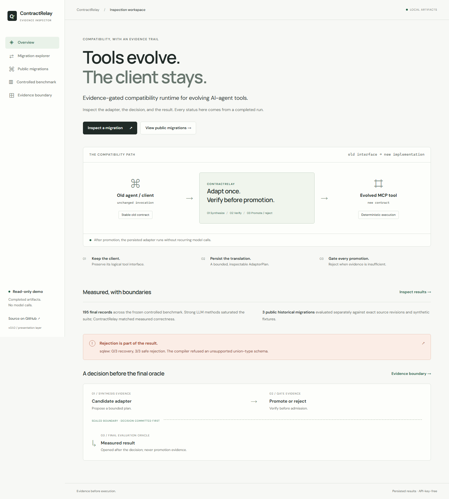

# ContractRelay

When an MCP tool changes its name, adds a required argument, or splits into several
tools, agents calling the old version break. I built ContractRelay to sit in front
of the new server and keep the old interface working. It enables a translation
only after independent checks of server behavior pass. Otherwise, it refuses.

**Example:** an unchanged `refund_order` call becomes three backend calls with
exact dollars-to-cents conversion. In the SQLite fixture, retrying the same request
does not duplicate either write.

[Live inspector](https://contractrelay-inspector.fondsky12.chatgpt.site) · [90-second walkthrough](docs/demo.md) · [Historical migration report](benchmarks/realworld-v1/REPORT.md)

[](https://github.com/sankalp-rajeev/ContractRelay/actions/workflows/ci.yml)
[](https://github.com/sankalp-rajeev/ContractRelay/actions/workflows/inspector.yml)

## Results

- **Controlled benchmark: 15 synthetic cases, 195 trial records.** Direct model
  tool use, generated wrappers, verified wrappers and ContractRelay each recovered
  **33/33 compatible trials** and safely rejected **12/12 must-reject trials**,
  with zero hidden false successes. The rules-only baseline recovered **9/11**
  compatible cases and safely rejected **4/4** must-reject cases. The final model
  saturated this suite: these results do not show that the adapter language or
  gate beats a plain model-generated wrapper.
- **Three historical migrations from public MCP projects.** Mindwtr and Nexus-MCP
  recovered in all three trials each. sqlew recovered **0/3**, with **3/3 safe
  rejections**, because my schema compiler refuses the consolidated tool's native
  union type. The [report](benchmarks/realworld-v1/REPORT.md) retains exact old/new
  commits, the failure, and the limits of the synthetic fixtures.
- **Known API cost: about $0.72.** The final controlled run accounts for
  $0.674484 and the historical runs for $0.04337325. Six retained outage attempts
  have unknown usage and are excluded; development runs are outside these totals.

The useful distinction here is a saved translation that runs deterministically
without recurring model calls after promotion. Finite tests do not prove semantic
equivalence, and these small evaluations do not establish production safety.



## Try it locally

Requires Node.js 22.12+ and pnpm 10.20.0; Node 22.23.3 is recommended for the UI tools.

```sh
pnpm ui:install
pnpm dev
```

Open **http://127.0.0.1:3000**. The inspector reads completed artifacts: contracts,
adapter operations, verification reports, execution observations and results. It
needs no API key or Docker and makes no model calls.

To run the local MCP/SQLite refund demonstration and the core checks:

```sh
pnpm install --frozen-lockfile
pnpm demo:refund
pnpm check
```

To use the product CLI without library APIs:

```sh
pnpm contractrelay verify --plan examples/cli/weather/adapter.json
pnpm --silent contractrelay serve --plan examples/cli/weather/adapter.json
```

The [CLI guide](docs/cli.md) covers `migrate --old ... --new ... --out ...`,
operator evidence, target configuration, and the API-free example. Only migration
synthesis may call Gemini. The first product CLI supports read-only MCP targets.

The refund fixture moves no real money. [Runtime commands and reproduction](docs/demo.md#runtime-commands)
cover the CLI, tests and optional synthesis. Model-backed commands are explicit;
they are never part of installing or opening the inspector.

## How it works

```text
Old agent call → stable old interface → saved adapter → evolved MCP tools
                                           ↑
                         generate once → verify → promote or reject
```

The model proposes a bounded declarative plan, such as renaming a parameter,
converting a value, projecting a response or composing allowlisted calls. Trusted
code executes those operations. The gate checks schema/policy, replayed traces,
independent properties and applicable state/side-effect observations before
promotion. Final evaluation evidence is opened only after the decision is recorded.

For writes, I use isolated fixtures with independent state and effect checks.
The runtime binds promotions to exact contract, plan and policy hashes and refuses
contract drift. Arbitrary generated baseline code runs only in a disposable Docker
sandbox. There is no hosted tool execution, account system or billing product.

## Find the engineering details

- [`packages/`](packages/): contract schemas, adapter language/compiler, synthesis,
  verification, promotion/runtime, MCP integration, benchmark runner and CLI.
- [`apps/inspector/`](apps/inspector/): Next.js, React, strict TypeScript and a
  read-only GraphQL API over persisted artifacts; local CSS and fonts.
- [`benchmarks/`](benchmarks/): frozen cases/protocols, final results and the
  separate public historical evaluation. [Evaluation methods](docs/benchmark.md)
  define the baselines, denominators and evidence separation.
- [`fixtures/synthetic/`](fixtures/synthetic/): weather and stateful refund fixtures.
- [`docs/inspector.md`](docs/inspector.md): UI architecture, schema, routes and audits.
  [Architecture decisions](docs/adr/README.md) and [related systems](docs/related-work.md)
  explain implementation choices and claim boundaries.
- [`docs/prd.md`](docs/prd.md): the unchanged original specification, archived for
  context. [Implementation history](docs/progress.md) records the build milestones;
  [the previous README](docs/history/readme-before-editorial.md) retains the detailed
  commissioning and quota history.

Core checks retain the original 146 tests and add 12 product CLI tests. The inspector adds ten API/component tests and six
desktop/mobile browser checks. Both run in CI without model credentials. The
[published final snapshot](benchmarks/results/final-v3.json) is the source for
displayed benchmark counts; the UI does not rescore or rerun the evaluation.
