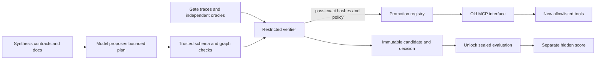

# Three-minute local demo

Start from Node 22.12+ with the pinned pnpm dependencies installed. No API key is
needed for this demonstration.

Run `pnpm demo:refund`. The unchanged logical `refund_order` call is translated
through `lookup_payment`, `refund_payment` and `update_order_status`. The amount
is converted exactly to cents. The real MCP client/proxy, independent gate,
promotion registry and sealed SQL checks are exercised. The sealed call is
replayed, and each write occurs once.

Run `pnpm exec vitest run packages/verifier/test/semantic.test.ts`. Both
send-vs-draft and delete-vs-deactivate return schema-valid surface success, yet
independent SQL observations reject the migrations. This demonstrates why
matching schemas and return values do not establish preserved effects.

Run `pnpm exec vitest run packages/mcp/test/refund.test.ts`. The bad-provenance
case passes the gate but fails sealed evaluation. The example deliberately
shows the limit of finite gate evidence; promotion and hidden success are
separate results.

For a separate-process MCP demonstration, run
`pnpm exec vitest run packages/mcp/test/stdio.test.ts`. An unchanged client sees
only the old `refund_order` interface and completes an idempotent retry.
`pnpm cli serve --fixture refund` exposes the same fixture over stdio for an
external MCP client. Only protocol messages go to stdout.

Live generation can be shown with `pnpm synthesize:refund --resume` after setting
the free-tier key in `.env`. This is a development acceptance demo. The benchmark
uses separate frozen cases, model jobs, independent trials and hidden scoring.

