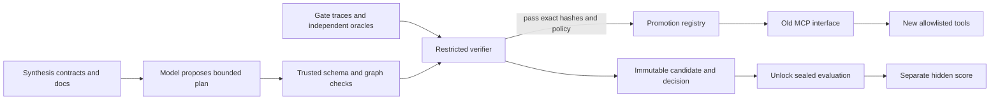

# 90-second walkthrough

Open the [live inspector](https://contract-relay.vercel.app/)
and follow these steps; every view reads completed artifacts.

1. **0:00-0:15 - The problem.** On the overview, follow the unchanged old client
   through a saved translation to the evolved MCP server. The model generates an
   adapter once; promoted execution makes no recurring model calls.
2. **0:15-0:40 - The refund.** Open the migration explorer's refund workflow.
   Compare old/new contracts, then inspect `ComposeCalls`: payment lookup, exact
   cents conversion, refund, and order update. Under execution observations,
   the separately labeled local replay records actual backend calls and a retry
   with one ledger entry. It is a demonstration, not a new benchmark trial.
3. **0:40-1:00 - The decision.** Inspect the V0-V3 verification report and its
   evidence boundary. Gate evidence admits an adapter; sealed evidence measures
   it later. These are different observations with different roles.
4. **1:00-1:15 - The failure.** Open sqlew under public migrations. Recovery is
   0/3; safe rejection is 3/3. My compiler's union-schema limitation is preserved,
   and there is no promoted execution trace.
5. **1:15-1:30 - The limit of the result.** Open the controlled benchmark.
   Strong model methods tied at the ceiling. The measured distinction is the
   persistent deterministic artifact, not better correctness on this suite.

## Runtime commands

The following local commands exercise the existing runtime rather than the
read-only inspector. Allow additional time to install dependencies and run tests.

Start from Node 22.12+ with the pinned pnpm dependencies installed. No API key is
needed for this demonstration.

Run `pnpm demo:refund`. The unchanged logical `refund_order` call is translated
through `lookup_payment`, `refund_payment` and `update_order_status`. The amount
is converted exactly to cents. The real MCP client/proxy, independent gate,
promotion registry and sealed SQL checks are exercised. The sealed call is
replayed, and each write occurs once.

Run `pnpm exec vitest run packages/verifier/test/semantic.test.ts`. Both
send-vs-draft and delete-vs-deactivate return schema-valid surface success, yet
independent SQL observations reject the migrations. This demonstrates why
matching schemas and return values do not establish preserved effects.

Run `pnpm exec vitest run packages/mcp/test/refund.test.ts`. The bad-provenance
case passes the gate but fails sealed evaluation. The example deliberately
shows the limit of finite gate evidence; promotion and hidden success are
separate results.

For a separate-process MCP demonstration, run
`pnpm exec vitest run packages/mcp/test/stdio.test.ts`. An unchanged client sees
only the old `refund_order` interface and completes an idempotent retry.
`pnpm cli serve --fixture refund` exposes the same fixture over stdio for an
external MCP client. Only protocol messages go to stdout.

Live generation can be shown with `pnpm synthesize:refund --resume` after setting
the Gemini key in `.env`. This is a development acceptance demo. The benchmark
uses separate frozen cases, model jobs, independent trials and hidden scoring.

